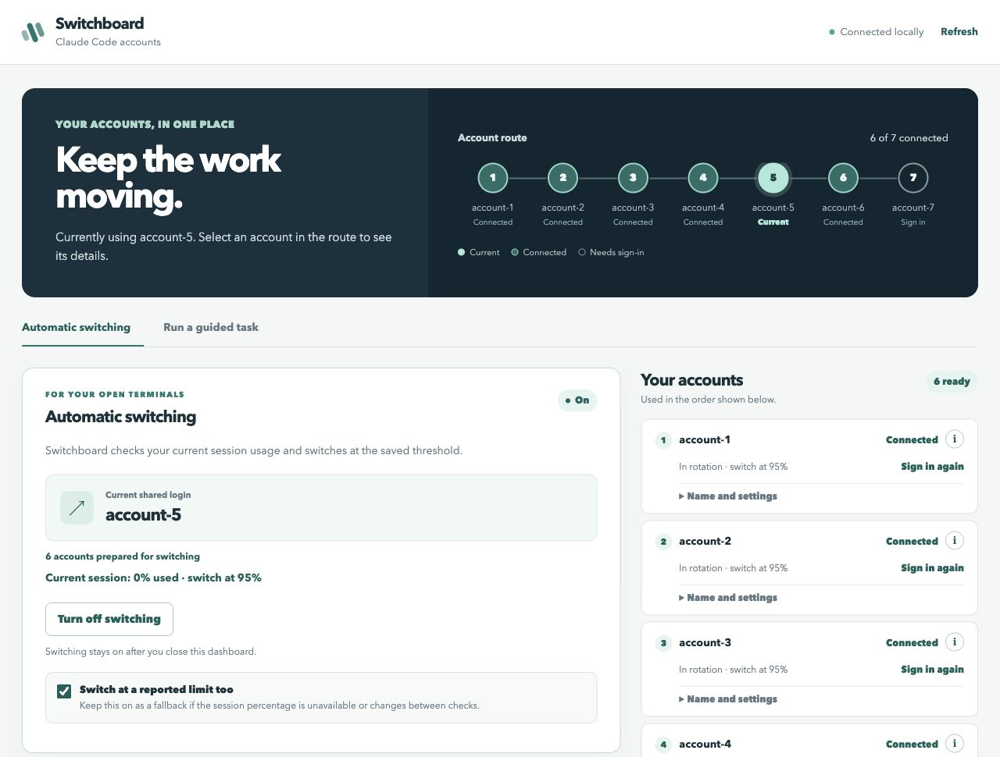

# Claude Auto Switch

**Keep working across your Claude Code accounts.** Switchboard is a local dashboard that switches the shared Claude login when the current account reaches your chosen session usage percentage.



Set a threshold such as **95%**, keep usage-limit switching as a fallback, and manage your accounts in one place. **Only current session usage is checked; weekly usage is not supported yet.**

## Before you start

You need [Claude Code](https://code.claude.com/docs/en/setup) 2.1.259 or newer, [uv](https://docs.astral.sh/uv/getting-started/installation/), Git, and at least two Claude accounts you control. uv manages Python for you.

| Platform | What you need for automatic switching |
| --- | --- |
| macOS 13+ (Apple Silicon or Intel) | Access to macOS Keychain |
| Ubuntu 20.04+, Debian 10+, other Linux desktops | systemd user services and an unlocked Secret Service, such as GNOME Keyring |
| Windows 10 1809+ or Windows 11 | Native `claude.exe` and permission to create a task for your signed-in user |

Linux and Windows remain **preview** ports: native components are tested, but live Claude switching and sign-in startup need desktop checks. See [platform setup and current PR status](docs/platform-support.md) for installation steps and the latest changes.

## Get started

### 1. Download and open Switchboard

Install the requirements above, then run these commands in Terminal or PowerShell:

```sh
git clone https://github.com/maqboolthoufeeq/claude-auto-switch.git
cd claude-auto-switch
uv sync
uv run launch.py
```

On native Windows, use `uv sync --python 3.14` for the install step. See the [Windows setup](docs/platform-support.md#native-windows) if your Claude installation only provides a batch file.

Use the browser tab opened by the launcher at **http://127.0.0.1:56729/**. The launcher creates the first configuration automatically and reopens an existing dashboard.

Next time, use **Open Switchboard.command** on macOS, **Open Switchboard.cmd** on Windows, or `./Open\ Switchboard.sh` on Linux.

### 2. Connect your accounts

In **Your accounts**, click **Sign in** and complete Claude's browser login for each account. Check the selected account and organization before finishing.

Open **Name and settings** to give each account a name you recognize and choose its switching percentage. Use **Add an account** if you need more profiles.

Profiles are created automatically in `profile/`. No passwords or `.env` file are needed.

### 3. Turn on automatic switching

1. Click **Prepare accounts** after signing in to at least two accounts.
2. If the current shared login says **Not matched yet**, choose an account under **Switch manually** and click **Switch account**.
3. Leave **Switch at a reported limit too** checked if you want the fallback. It is on by default.
4. Click **Turn on automatic switching**.
5. Open new Claude chats in your project terminals using the normal `claude` command.

The monitor checks usage about every 30 seconds and switches when a check observes the saved threshold. It keeps running after you close the dashboard. Switchboard changes the shared login without restarting your terminals; retry an interrupted message after switching. Before relying on existing chats continuing under the new account, complete the [two-terminal check](docs/testing.md#2-test-two-open-claude-chats).

## Everyday use

| To do this | Use this |
| --- | --- |
| See the current account and connection status | The account route at the top |
| Rename an account or change its percentage | **Name and settings** |
| See details, activity, logout, or delete controls | The account's **i** button |
| Change the shared login immediately | **Switch manually** |
| Stop background switching | **Turn off switching** |

Deleting an account signs out its profile and removes its saved Switchboard login. Local chat history stays on your computer. Switch away from the active account before removing it.

## Optional: let Switchboard run a task

Turn off automatic switching, then open **Run a guided task**. Choose your project, describe the task, and click **Start task**. This mode starts Claude for you and passes a saved handoff to the next profile at a usage limit. Keep the launcher open; use **Continue saved task** if it pauses.

## Privacy and limits

- Saved switching credentials live in **macOS Keychain**, **Linux Secret Service**, or **Windows Credential Manager**. Switchboard never falls back to plaintext for its saved switching copies. Claude manages its own active credential files on Linux and Windows.
- Profiles, configuration, private dashboard links, and logs are excluded from Git. Sign in separately on each computer; do not copy or publish profile folders.
- The dashboard runs locally and requires its private launcher link. Opening `ui/index.html` directly does not connect it.
- Terminal chats must use the default Claude login. Separate profiles, API keys, and fixed OAuth tokens do not follow shared switching.
- Changes to Claude's `/usage` display can make percentage checks unavailable. Keep the limit fallback enabled if you want switching to continue at reported limits.

## If something needs attention

| What you see | What to do |
| --- | --- |
| **Config already exists** during setup | Skip `rotator.py init` and open the dashboard. |
| **Needs sign-in** or an expired saved login | Turn switching off, sign in again, prepare accounts again, then turn switching on. |
| **Session percentage unavailable** | Open `claude` once from the Switchboard project folder and complete any initial setup. Keep the limit fallback on. |
| **Update saved account access** | Click it once to move older saved credentials to the updated Keychain path. macOS may request access to the older items. |
| An invalid private link or an old launcher message | Reopen Switchboard through its launcher. Close the older launcher first if it is still running. |
| A Linux credential-store or monitor startup error | Use your normal desktop session, unlock its keyring, and check [Linux setup](docs/platform-support.md#ubuntu-and-linux-desktops). |
| A Windows monitor startup error | Use the same signed-in Windows user for Switchboard and Claude; check [Windows setup](docs/platform-support.md#native-windows). |

macOS may request Keychain approval again if the Keychain is locked or its permissions are reset.

On Linux, unlock the credential store in your desktop session before preparing accounts. On Windows, the monitor runs as your logged-in user through Task Scheduler, without an administrator account or a saved Windows password.

For terminal commands, custom usage checks, and development instructions, see the [advanced guide](docs/advanced.md).

To check the software yourself, follow the [testing guide](docs/testing.md). See [platform support](docs/platform-support.md) for installation details and verified test coverage.
